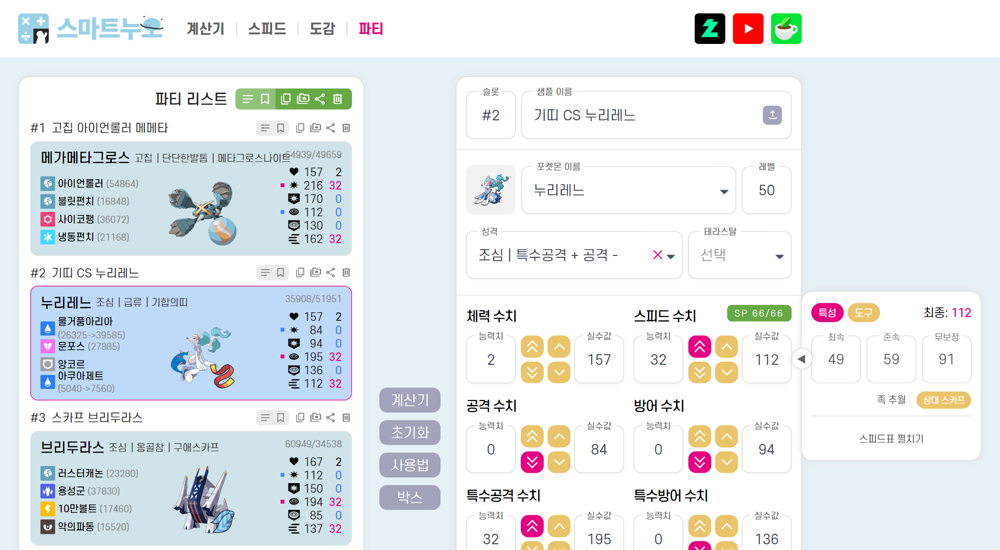
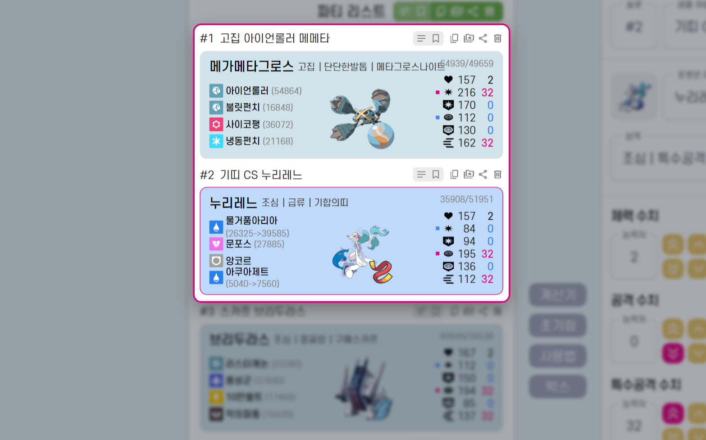
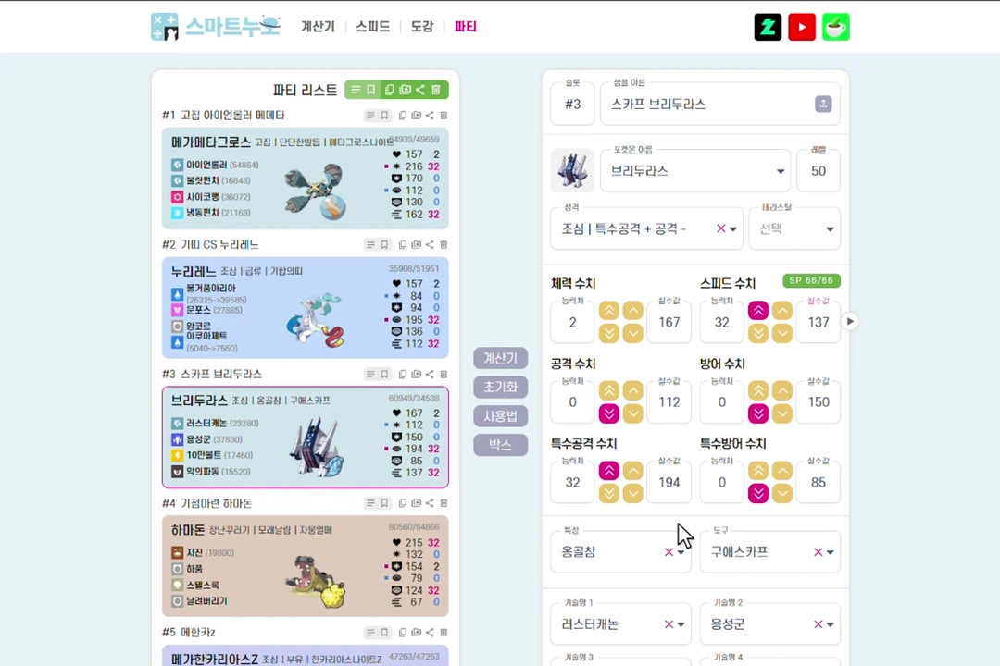
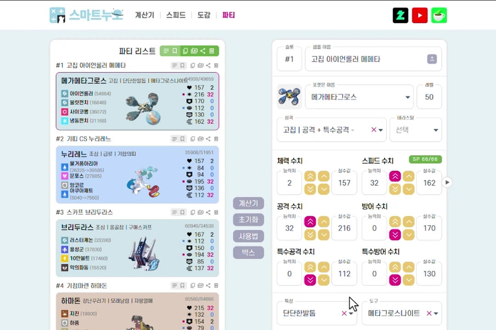
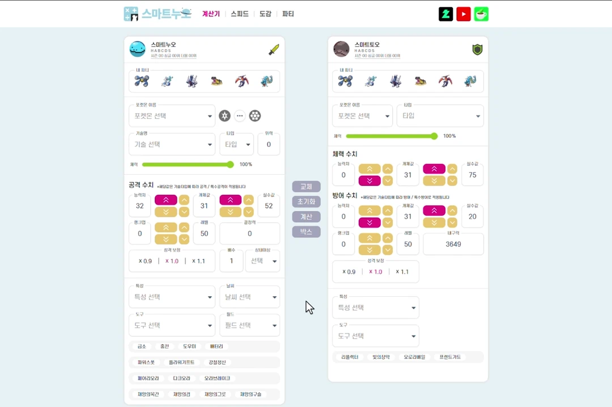
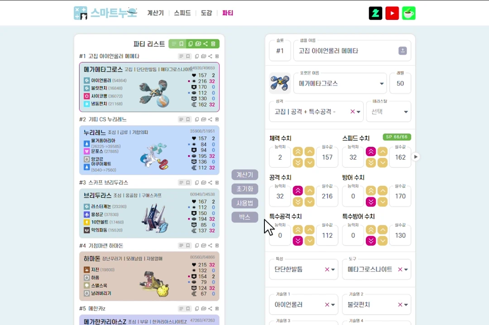

# Douminuo (Chrome extension v2.0.0)

[한국어](README.md) | **English**

## About

> **Douminuo** (도우미누오) is an unofficial quality-of-life extension for [smartnuo](https://smartnuo.com) (스마트누오), a Korean-language competitive Pokémon site with a damage calculator, speed checker and team builder. It currently supports Pokémon Champions singles.
>
> 

> 
About the name

>
> 도우미 (doumi) means "helper" and is also the Korean name of the move Helping Hand. 누오 (Nuo) is the Korean name for Quagsire, smartnuo's mascot.
>
> 

 

- Power and bulk for each team member, updated as you edit
- Your Pokémon's speed tier: which base Speed values it outspeeds
- Save sets and teams to the Box and load them later
- Auto-fill your Pokémon into the damage calculator
- Copy your team or a single set as text to post elsewhere
- Export in English, in Pokémon Showdown / PokePaste format

---

## Installation

### Chrome Web Store (recommended)

Open the [Chrome Web Store page](https://chromewebstore.google.com/detail/bmgohocnliecjcefhnaakbdcfjcdmoan?utm_source=item-share-cb) and click **Add to Chrome**.
It updates automatically.

### From a GitHub release

1. Pick a version from this repository's Releases.
2. Download the attached `douminuo-x.x.x.zip` and unzip it.
3. Open Chrome's extensions page in one of two ways:
    - Type `chrome://extensions` in the address bar.
    - Click the three-dot menu (top right) → Extensions → Manage Extensions.
4. Turn on **Developer mode** (top right).
5. Click **Load unpacked** (top left).
6. Select the folder you unzipped in step 2.
7. When the Douminuo icon appears, it's installed.

To update, repeat these steps with the new release zip. You can also unzip it over the old folder and click the reload button (↻) on the extension in `chrome://extensions`.

---

## Features and usage

### Team Power and bulk

Shows Power and bulk for every Pokémon on your team and updates them as the team changes.

- **Power (결정력)** is a measure of offensive strength common in the Korean community, shown after each move. It's roughly the attacking stat × move base power × STAB × item and Ability modifiers. When a modifier only applies under a condition (weather, terrain, low HP and so on), you see both values as `base→boosted`.
- **Bulk (내구력)** is HP × Defense for physical bulk and HP × Sp. Def for special bulk, with item and Ability modifiers. It sits in the card's top-right corner as `physical/special`.

### Speed tiers

Shows which base Speed values your Pokémon outspeeds, based on the current regulation's speed tiers, and updates as you change its stats.

### Saving and loading sets and teams

You can save sets (샘플) and teams (파티) to the Box.
Click the **Box (박스)** button in the middle of the page to open it and load anything you saved.

The Box holds up to 100 sets and 20 teams.

### Damage calculator auto-fill

Quickly puts any Pokémon from your team into the damage calculator.
You can also pick a set you saved in the Box.

### Set text export

Copies your team or a single set as text you can paste into community posts or blogs.
Settings lets you choose what goes in:
- **Share URL:** a link that smartnuo's team page (파티) can import back as a set.
- **Final stats (실수치):** each Pokémon's final stat values.
- **Power (결정력):** Power for each move, with held item and Ability effects applied.
- **Bulk (내구력):** physical and special bulk, with held item and Ability effects applied.
- **Showdown:** converts the text to Pokémon Showdown / PokePaste format.

### Settings

Open Settings from the gear button at the top right of the Box, or click the Douminuo icon in Chrome's toolbar.
You can turn each feature on or off there.

---

## FAQ

---

## Privacy and permissions

This extension does not collect or send any personal information.
All settings stay in your browser's local storage.
See [PRIVACY.md](./PRIVACY.md) for details.

---

## Bug reports and feature requests

If you run into a problem or have an idea, click the **Contact / Report (문의·제보)** button at the bottom of Settings, or use [this form](https://docs.google.com/forms/d/e/1FAIpQLSfA97NKxUqModwfLulTKqiBrSmnYvwPUEaMXa1__-lP5orG1Q/viewform?usp=header) (in Korean).

---

## License and disclaimer

Douminuo is an unofficial tool made by one person and is not affiliated with smartnuo or its operators.
If smartnuo changes its site, some features may stop working or work only partly, without notice.
If you share it anywhere other than the Chrome Web Store, please include the installation steps above.

The source code is public for transparency only and has no open-source license. Unless the author explicitly permits it, the author keeps all rights to the code and assets in this repository (All rights reserved).
