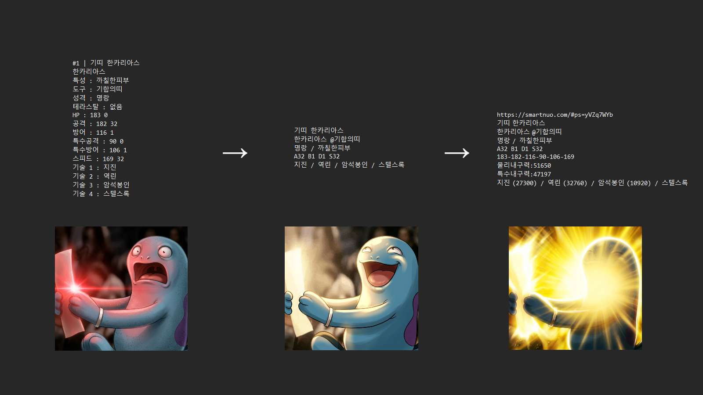

# 도우미누오 (크롬 확장 프로그램 v2.0.0)

## 소개

> **도우미누오**는 [스마트누오](https://smartnuo.com) 사용자를 위한 **비공식 편의성 확장 프로그램**입니다.

- 내 파티의 **결정력**과 **내구력**을 실시간으로 확인
- 내 포켓몬의 **스피드 추월컷**을 실시간으로 확인
- 파티에 있는 포켓몬을 **계산기에 자동 입력**
- **샘플과 파티를 저장**하고 나중에 다시 **불러오기**
- 내 파티와 포켓몬 샘플을 다른곳에 올리기 쉽게 **텍스트로 복사**
- **Pokémon Showdown / PokePaste** 스타일의 영문 변환 및 복붙 지원

---

## 설치

### Chrome 웹 스토어 (권장)

[크롬 웹스토어](https://chromewebstore.google.com/detail/bmgohocnliecjcefhnaakbdcfjcdmoan?utm_source=item-share-cb)에 들어가 **Chrome에 추가** 버튼을 누르면 설치가 완료됩니다.
**자동 업데이트**를 지원합니다.

### GitHub 릴리즈에서 설치

1. GitHub 저장소의 Releases에서 원하는 버전을 고릅니다.
2. 해당 버전에 첨부된 `douminuo-x.x.x.zip`을 내려받고 압축을 풉니다.
3. 크롬에서 확장 프로그램 창을 엽니다.
    - **방법 1:** 주소창에 `chrome://extensions` 를 입력합니다.
    - **방법 2:** 오른쪽 위 점 세 개(더보기) → 확장 프로그램 → 확장 프로그램 관리를 클릭합니다.
4. 오른쪽 위 개발자 모드를 켭니다.
5. 왼쪽 위 압축해제된 확장 프로그램 로드를 누릅니다.
6. 위 3번 압축을 푼 폴더를 선택합니다.
7. 도우미누오 아이콘이 보이면 설치 완료입니다.

업데이트할 때는 새 릴리즈 zip으로 같은 절차를 반복하거나, 압축을 풀어 기존 폴더를 덮어쓴 뒤 `chrome://extensions` 에서 해당 확장 프로그램의 새로고침(↻) 을 누르면 됩니다.

---

## 기능 소개 및 사용법

### 파티 결정력 및 내구력 표시

내 포켓몬들의 결정력과 내구력을 실시간으로 확인할 수 있습니다.

### 스피드 추월표

내 포켓몬이 스피드 몇 족까지 추월 가능한지 실시간으로 확인할 수 있습니다.

### 샘플·파티 저장 및 불러오기

파티 페이지 아이콘 줄의 저장 버튼으로 샘플과 파티를 저장하여 보관할 수 있습니다.
- **샘플:** 각 슬롯(#1~#6) 줄의 저장 버튼
- **파티:** 파티 리스트 초록 아이콘 묶음의 저장 버튼 (이름을 붙여 저장)

보관한 샘플·파티는 페이지 가운데 **박스** 버튼에서 불러올 수 있습니다.
파티 페이지에서는 샘플을 현재 편집 중인 슬롯에, 파티를 6마리 통째로 불러옵니다.

샘플은 최대 100개, 파티는 최대 20개까지 보관 가능합니다.

### 계산기 자동 입력

파티에 있는 포켓몬을 계산기에 자동으로 빠르게 넣을 수 있습니다.
가운데 **박스** 버튼에서 보관해둔 샘플을 골라 공격측 또는 수비측에 넣을 수도 있습니다.

### 샘플 텍스트 변환

내 파티 혹은 샘플을 다른 커뮤니티 및 블로그에 올리기 쉽게 텍스트로 변환해 복사해줍니다.
환경설정에서 포함하고 싶은 항목을 켜고 끌 수 있습니다.
- **공유 URL:** 이 URL을 통해 파티 페이지에서 샘플로 변환해 불러올 수 있습니다.
- **실수치:** 실수치를 추가합니다. 
- **결정력:** 각 기술에 결정력을 추가합니다. 지닌물건과 특성의 효과를 반영합니다.
- **내구력:** 물리내구 및 특수내구를 추가합니다. 지닌물건과 특성의 효과를 반영합니다.
- **Showdown:** Pokémon Showdown / PokePaste 형식으로 변환합니다.

### 환경설정

페이지 가운데 **박스** 버튼 → 오른쪽 위 톱니 버튼, 또는 크롬 툴바의 도우미누오 아이콘을 클릭해 환경설정에 들어갈 수 있습니다.
원하는 기능을 켜고 끌 수 있습니다.

---

## 자주 묻는 질문

---

## 개인정보 보호 및 권한

본 확장 프로그램은 사용자의 어떠한 개인정보도 수집하거나 전송하지 않습니다.
모든 환경설정 데이터는 브라우저 로컬 저장소에만 안전하게 보관됩니다.
자세한 내용은 [PRIVACY.md](./PRIVACY.md) 를 참고해 주세요.

---

## 버그 제보 및 기능 건의

이용 중 문제가 발생하거나 개선 아이디어가 있다면, 환경설정 하단의 **문의·제보** 버튼을 클릭하거나 [여기](https://docs.google.com/forms/d/e/1FAIpQLSfA97NKxUqModwfLulTKqiBrSmnYvwPUEaMXa1__-lP5orG1Q/viewform?usp=header)를 이용해 주세요.

---

## 라이선스·면책

본 확장 프로그램은 개인이 개발한 비공식 편의 도구로, 스마트누오 공식 운영진과는 어떠한 제휴나 협력 관계도 없습니다.
스마트누오 웹사이트의 업데이트나 구조 변경 등으로 인해, 일부 기능이 예고 없이 정상적으로 작동하지 않거나 제한될 수 있습니다.
또한 크롬 웹 스토어가 아닌 경로로 배포되는 경우, 설치하는 분께 반드시 위의 설치 방법을 함께 안내해 주세요.

본 저장소의 소스 코드는 투명성 확보를 위해 공개되어 있을 뿐, 명시적인 공개 라이선스가 부여되어 있지 않습니다. 별도의 명시적 허락이 없는 한 본 저장소 내 모든 코드와 에셋에 대한 권리는 저작자가 보유합니다 (**All rights reserved**).